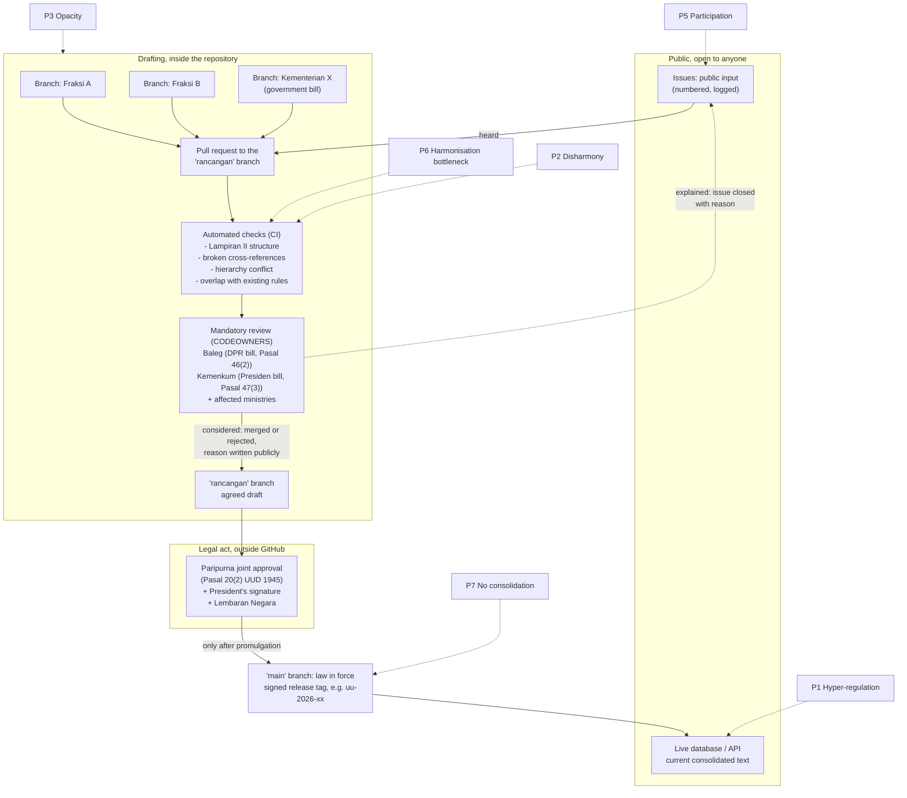

# GitHub as infrastructure for Indonesian law-making (research note)

**Date:** 2026-11-22
**Status:** _Draft, not yet reviewed by the owner._ Built with Claude Code.
**Experiment log:** [`experiments/2026-11-22-github-legal-production.md`](../experiments/2026-11-22-github-legal-production.md)
**Column version:** [`content/column/github-sebagai-ruang-legislasi.md`](../content/column/github-sebagai-ruang-legislasi.md)

> Independent personal research. Not affiliated with or endorsed by any employer.
> Experimental. Unverified unless marked as reviewed. Not legal advice, and not legal research to rely on.

## Question

Which of Indonesia's documented law-making problems could a Git/GitHub workflow actually solve, which can it only support, and which can it not touch? What do foreign examples teach about how it works in practice?

## Starting point: what a repository can and cannot do

A merged pull request has no legal force. A law is valid because the body authorised by the Constitution adopted it under the required procedure. For a UU, that means joint approval in the DPR plenary (Pasal 20 ayat (2) UUD 1945), then signature by the President.
So GitHub can only be **infrastructure**: the place where drafts live, changes are recorded, reviews happen and the published text is kept current. It cannot be the **source of validity**.

The same limit applies to the earlier TAP MPR idea. Since the constitutional amendments the MPR no longer issues rule-making (regeling) TAPs. Under the Penjelasan of Pasal 7 ayat (1) huruf b UU 12/2011, only the TAPs that TAP MPR I/MPR/2003 kept in force sit at that level of the hierarchy. TAP MPR I/2003 itself is a useful precedent for something else, though: it was a one-time "legacy refactor" that sorted every TAP from 1960–2002 into revoked, still in force, and spent.

## 1. The problems (latest data found)

| # | Problem | Evidence | Source quality |
|---|---|---|---|
| P1 | **Hyper-regulation (obesitas regulasi)** | PSHK's widely cited count is 42,996 regulations: 8,414 central, 14,453 ministerial, 4,164 from non-ministerial agencies, 15,965 regional. In October 2026 the Minister of Law said the ministry had cut 195 of its own regulations (Permenkum) to 34. | The PSHK count dates from around 2019–2020. **No newer PSHK count was found.** The 195→34 figure comes from press reports. |
| P2 | **Disharmony and overlap** | PSHK: about two-thirds of executive regulations come from ministries, and they overlap with each other. At the Forum Nasional Pembangunan Hukum (15 Oct 2026) the Minister named sectoral ego (ego sektoral) as the cause and set out two strategies, RIA and substantive harmonisation. | The PSHK finding is from 2019 (with Bappenas). The 2026 statement is from press reports. |
| P3 | **Opaque drafting** | PSHK monitoring for 2025: 87.5% of the Prolegnas Prioritas bills had no draft and no Naskah Akademik on the DPR website, and 71.4% had no session documents. Of the 9 bills passed, only 1 had both its draft and its Naskah Akademik online. In September 2026 the draft of the asset-forfeiture bill (RUU Perampasan Aset) was still unpublished while being "tidied up". | PSHK Catatan Akhir Tahun 2025 (read through press summaries; pshk.or.id could not be reached from the build environment). |
| P4 | **Planning that doesn't hold** | 9 of the 52 Prolegnas Prioritas 2025 bills were passed. The list grew from 41 to 52 during the year, and bills outside the list (BUMN, Minerba) were passed anyway. Achievement over 2020–2025 was about 8–22% of target. | PSHK 2025, Katadata/Databoks. |
| P5 | **Meaningful participation in form only** | Putusan MK 91/PUU-XVIII/2020 led to Pasal 96 UU 13/2022 on meaningful participation. A 2026 MK case (78/PUU-XXIV/2026) still uses both as its yardstick. The law does not clearly require drafts to be published. | The court decision and statute are primary sources. The interpretive point is secondary. |
| P6 | **Harmonisation bottleneck** | In 2025 the Ministry of Law received 11,392 harmonisation requests and completed 11,191. The e-Harmonisasi application launched in February 2025 and became the main channel under Permenkum 7/2026. The Riau regional office reports too few legislative drafters (perancang) for the volume of requests. | Ministry performance reports, via press. |
| P7 | **No official consolidated text** | Official portals publish the original texts. Consolidations (the law "as amended") are made privately or unofficially. Pasal.id labels its own as "Konsolidasi tidak resmi". This lab had to build one by hand for UU ITE. | Primary: the portals themselves, plus this lab's [UU ITE experiment](../experiments/2026-11-14-uu-ite-consolidation.md). |
| P8 | **Weak regulatory-quality perception** | World Bank WGI Regulatory Quality for Indonesia: estimate 0.12 in 2024, down from 0.34 in 2023 (scale −2.5 to +2.5). | **Secondary aggregator.** The World Bank revised the whole series in December 2025, so check against govindicators.org before citing. |

## 2. Which problems Git can solve

Rating: **Solves** = Git provides the mechanism directly. **Supports** = Git helps, but the real fix is institutional. **Doesn't touch** = the cause is political.

| # | Problem | Rating | Git mechanism | Why it matters |
|---|---|---|---|---|
| P7 | No official consolidated text | **Solves** | Each amending law is one commit to the current text. `git log` gives the amendment history for each Pasal. A tagged release gives the text as of any date. | It's the core use in every foreign example (DC, Spain, Germany). Answers "which version applies today?", the [database problem](../content/beyond-statutes/law-is-a-database-problem.md). |
| P3 | Opaque drafting | **Solves (if mandated)** | A public repository from the first draft. Every version stays in history, with an author and a timestamp. | It turns "the draft is still being tidied up" into a visible commit history. The technology is trivial. The obstacle is political will. |
| P6 | Harmonisation bottleneck | **Supports** | Pull-request review; `CODEOWNERS` makes review by each affected ministry or committee mandatory; automated checks (CI) catch mechanical errors before a human looks. | It frees scarce drafters for substance. Routine checks (Lampiran II structure, broken references, hierarchy) run automatically. |
| P2 | Disharmony and overlap | **Supports** | One corpus in a single repository, searchable across sectors. CI can flag a new draft that touches the same subject or Pasal as an existing rule. | It makes overlap visible **before** enactment. It can't resolve ego sektoral, but it removes the excuse of "we didn't know". |
| P5 | Participation in form only | **Supports** | Issues as a public, numbered intake for input. Each issue is closed with a written reason or linked to the commit that took it on. | It maps onto the three rights in Putusan MK 91/PUU-XVIII/2020: to be heard (the issue is filed), to be considered (it's linked to a review), to be given an explanation (the closing comment). It also acts as a **live database**: the public sees the current text, not a stale PDF. |
| P1 | Hyper-regulation | **Supports (indirectly)** | A full inventory with status labels; "archiving" spent rules; a dashboard of rules with no recent activity. | Simplification starts with a count. TAP MPR I/2003 and the Permenkum 195→34 cut were done by hand. A repository makes that kind of stock-take continuous. |
| P4 | Planning that doesn't hold | **Doesn't touch** | A Projects board could track the Prolegnas publicly. | Missing targets is a political choice. Visibility helps outside monitors (like PSHK) but doesn't change incentives. |
| P8 | Regulatory-quality perception | **Doesn't touch** (directly) | None. | It's an outcome indicator and would move only if P2, P3, P6 and P7 improve. |

### The owner's design point: fraction branches, merged by the legislation body

The owner's proposal is that each fraction (fraksi) submits its changes as its own branch and pull request, which the head of the legislation body (Baleg) merges. The current law supports the "maintainer" idea:

- Pasal 46 ayat (2) UU 12/2011: harmonisation of bills **from the DPR** is coordinated by the DPR body that handles legislation (Baleg).
- Pasal 47 ayat (3) UU 12/2011: harmonisation of bills **from the President** is coordinated by the minister for law.

So a repository would have two maintainer roles, Baleg and the Ministry of Law, depending on where the bill comes from. Three design corrections:

1. **Merge ≠ enactment.** The `rancangan` (draft) branch can be merged by Baleg. The `main` branch, the law in force, should only move when the plenary approves and the text is promulgated, and a signed release tag should record that.
2. **A single merger is a single gatekeeper.** Branch protection should require approval from more than one fraction, or at least make every rejected pull request public with its reason. Otherwise the repository simply moves the backroom into a new room.
3. **The real negotiation (lobbying, the DIM list in the working committee, Panja) happens off the record.** A branch per fraction makes each fraction's position attributable. That is precisely why fractions may refuse to use it. The value is accountability, and that is also where the resistance will come from.

## 3. How other countries do it

| Example | Status | Mechanism | Lesson for Indonesia |
|---|---|---|---|
| **Washington DC** (DC Council, with Open Law Library) | **Official.** The GitHub copy is the authoritative digital code. | Enacted laws are codified as XML in `DCCouncil` repositories and published within about a week of enactment. In 2018 a citizen's pull request fixing a codification typo was merged. | The PR fixed **codification**, not substance. Substance still changes only through Council legislation. That is the right separation for Indonesia: Git for the text, the legislature for validity. |
| **EU** (LEOS / "EdiT", European Commission) | **Official**, used internally | Open-source drafting editor; texts in Akoma Ntoso XML; code hosted on the EU's **own** `code.europa.eu`, not github.com. | The sovereignty answer: governments use Git principles on infrastructure they control. Indonesia could do the same (self-hosted Git on national data centres). |
| **US House** (Comparative Print Suite) | **Official**, required by House Rule XXI clause 12 | Generates prints showing how a bill would change current law, and how two versions differ. | Diffs as a **procedural duty**, not a nicety. An Indonesian equivalent would be a mandatory comparison matrix attached to every bill. |
| **Spain** (`legalize-es`, 2026) | Civic, unofficial | Pulls the BOE's official consolidated-legislation API into Markdown; each reform is a commit. | It only worked because the state already publishes consolidated text through an open API. Indonesia doesn't yet (P7), so that's the first public good to ask for. |
| **Germany** (`bundestag/gesetze`) | Civic, unofficial; reported unmaintained | Federal laws converted to Markdown from the official XML. | Without an institutional owner, mirrors die. Ownership matters more than tooling. |
| **France** (La Fabrique de la Loi) | Academic or civic | Visualises amendments at every legislative stage; selected bills in Git (GitLab). | Legislative history becomes readable for non-lawyers. That is a participation tool in itself. |

## 4. Diagram (bagan)

How to read it: solid arrows are the workflow. Dotted arrows show which documented problem each part addresses. The legal act (the box in the middle) deliberately stays outside the repository.

## 5. Critiques

1. **Data sovereignty.** github.com is a US platform owned by Microsoft. PP 71/2019 Pasal 20 ayat (2) requires public-scope electronic system operators to manage, process and store their systems and data **in Indonesia**. Ayat (3) allows storage abroad only where the storage technology isn't available domestically, and Git hosting clearly is. So an official Indonesian deployment would have to be **self-hosted Git** (e.g., Gitea/GitLab on national data centres), the EU model, not github.com. A public **mirror** on GitHub for reach is a separate, easier question.
2. **Authenticity.** The authoritative text today is the promulgated text in the Lembaran Negara and its certified copy (salinan). A repository becomes authoritative only if a legal instrument says so, as DC did. Releases would also need digital signatures from a certificate authority the state recognises. Even Pasal.id reports "signature integrity: unverified" for the texts it serves, which shows the gap.
3. **Git's model of change is not the law's.** Indonesian amending laws are written as *instructions* ("Ketentuan Pasal 27 diubah sehingga berbunyi…"), not as diffs. Someone has to translate each instruction into a commit, and errors can creep in. This lab hit exactly that in the UU ITE consolidation. The Cornell LII critique of "law in Git" makes the same point.
4. **Digital divide.** GitHub favours people who can already code. Issues must be fed by other channels (SIMAS PUU, public hearings, regional consultations) and summarised back, or "participation by pull request" becomes a new elite.
5. **Transparency theatre.** A public repository where real decisions happen off the record is worse than none, because it looks like accountability. The value depends on a rule that **only** text in the repository counts.
6. **Duplication with e-Harmonisasi.** The government already has a digital harmonisation channel (Permenkum 7/2026). The realistic path is to add version control, public diffs and an open API to what exists, not to build a rival system.

## Limitations of this note

- pshk.or.id and kompas.id could not be reached from the build environment. PSHK 2025 figures come from search-engine summaries of press coverage and must be checked against the PSHK PDF.
- The newest PSHK regulation count found dates from around 2019–2020.
- The WGI figures are from a secondary site.
- The owner's own journal in the local "Regulatory Making" folder was **not** read (the folder isn't reachable from the cloud session). Its findings still need merging in.

## Sources

**01 Official (primary)**
- UU 12/2011 Pasal 46–47: https://pasal.id/peraturan/uu/uu-no-12-tahun-2011 (official: https://peraturan.bpk.go.id/Details/39188/uu-no-12-tahun-2011)
- UU 13/2022 (Pasal 96, meaningful participation): https://peraturan.go.id/id/uu-no-13-tahun-2022
- PP 71/2019 Pasal 20–21: https://peraturan.go.id/id/pp-no-71-tahun-2019
- Permenkum 7/2026 (e-Harmonisasi): https://peraturan.go.id/files/permenkum-no-7-tahun-2026.pdf
- MK 78/PUU-XXIV/2026 summary: https://s.mkri.id/public/content/persidangan/sinopsis/ (ikhtisar 78/PUU-XXIV/2026)
- DPR Setjen presentation on SIMAS PUU: https://berkas.dpr.go.id/setjen/dokumen/-Regulasi-dan-Dokumen-Paparan-OPI-Partisipasi-Publik-Dalam-Legislasi-oleh-Hj.-Ledia-Hanifa-S.Si.-M.PSi.T-1622102422.pdf

**02 Research and civil society**
- PSHK, Catatan Akhir Tahun Kinerja Legislasi 2025: https://www.pshk.or.id/publikasi/catatan-akhir-tahun-pshk-tentang-kinerja-legislasi-tahun-2025-2/
- PSHK, Obesitas Regulasi: https://pshk.or.id/rr/obesitas-regulasi/
- Katadata/Databoks, DPR legislation achievement 2020–2025: https://databoks.katadata.co.id/pendidikan/statistik/69574030d84fd/selama-2020-2025-capaian-legislasi-dpr-ri-selalu-kurang-dari-25
- Kompas.id, DPR 2025 legislative performance: https://www.kompas.id/artikel/en-kinerja-legislasi-dpr-2025-ketika-prolegnas-dilupakan-dan-kehilangan-makna
- Kontan, unpublished RUU Perampasan Aset draft: https://insight.kontan.co.id/news/draf-ruu-perampasan-aset-masih-jadi-rahasia-berpotensi-melanggar-uu-132022-1
- Metro TV, the Minister's two regulatory strategies (Oct 2026): https://www.metrotvnews.com/read/KZmC4W95-menkum-beberkan-2-strategi-penataan-regulasi
- RCTI+/Okezone, 195 Permenkum cut to 34: https://www.rctiplus.com/news/detail/okezone/5494460/pangkas-195-permenkum-jadi-34--menkum--untuk-kepastian-hukum-dan-pelayanan-publik
- Metro TV, Ministry of Law performance (harmonisation figures): https://www.metrotvnews.com/read/KXyCQgJv-1-tahun-kinerja-moncer-kementerian-hukum-pilar-kuat-mendukung-visi-prabowo-gibran
- RRI, HARMONITAS Riau (drafter shortage): https://rri.co.id/pekanbaru/regional/2627877/harmonitas-siap-hadir-kemenkum-riau-satukan-proses-harmonisasi-ranperda
- World Bank WGI: https://www.worldbank.org/en/publication/worldwide-governance-indicators ; secondary: https://www.theglobaleconomy.com/Indonesia/wb_regulatory_quality/

**03 Foreign examples**
- DC Council GitHub: https://github.com/DCCouncil ; Ars Technica (2018, archived): https://webcf.waybackmachine.org/web/20211001074126/https://arstechnica.com/tech-policy/2018/11/how-i-changed-the-law-with-a-github-pull-request ; DCist: https://dcist.com/story/18/11/28/github-is-a-programming-website-so-what-is-d-c-s-legal-code-doing-on-there
- Open Law Library: https://github.com/openlawlibrary
- EU LEOS: https://interoperable-europe.ec.europa.eu/collection/justice-law-and-security/solution/leos-open-source-software-editing-legislation
- US House Comparative Print Suite: https://civictech.guide/projects/comparative-print-suite ; Clerk reports: https://cha.house.gov/
- legalize-es: https://www.xataka.com/aplicaciones/alguien-ha-cogido-12-000-leyes-espanolas-ha-pasado-a-codigo-fuente-autentica-joya-para-buscar-legislacion
- bundestag/gesetze: https://github.com/bundestag/gesetze
- Cornell LII critique (Tom Bruce): https://blog.law.cornell.edu/tbruce/page/2/
- Slaw, "GitHub: where law meets technology?": https://www.slaw.ca/2014/06/02/git-where-law-meets-technology/

Source regulation text is public domain under Pasal 42 UU 28/2014 (Hak Cipta).
